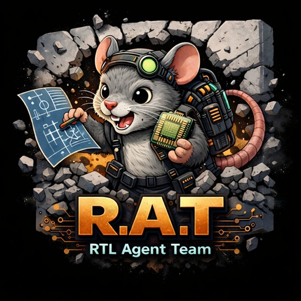
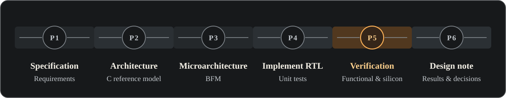

[한국어](README_kr.md)

# RTL Agent Team



A Claude Code plugin for RTL design and verification with 91 specialized AI agents and 56 skills.



The full flow produces design documents, RTL and testbenches, then records the verification results in a design note.

## Quick Start

**Check your EDA environment before starting a design.** Lint, simulation, and synthesis can produce verification evidence only when the tools required for that phase actually run. The plugin's hooks and helpers need Python 3.9 or newer; `rat-setup` and `rat-doctor` check it. [EDA setup guide](plugin_docs/eda-setup-guide.md)

In Claude Code, install the published plugin (v0.14.6):

```text
/plugin marketplace add babyworm/rtl-agent-team
/plugin install rtl-agent-team
```

From your RTL project directory, set up the tools, initialize the project, and
start with your specification:

```text
/rtl-agent-team:rat-setup
/rtl-agent-team:rat-init-project
/rtl-agent-team:rat-auto-design specs/design.md
```

For remote EDA, give `rat-setup` the SSH alias, target phase, and site setup
script if needed. A private default site also works before project initialization.
Keep connection details outside this plugin repository. [EDA setup, including Docker](plugin_docs/eda-setup-guide.md)

## Key commands

| Command | When to use it |
| --- | --- |
| [`rat-setup`](skills/rat-setup/SKILL.md) | Check that the selected EDA tools run in your environment. |
| [`rat-init-project`](skills/rat-init-project/SKILL.md) | Create the project layout, tool settings, and runner scripts. |
| [`rat-doctor`](skills/rat-doctor/SKILL.md) | Check plugin and project settings when something misbehaves, and fix what is wrong. |
| [`rat-auto-design`](skills/rat-auto-design/SKILL.md) | Run P1–P6 from a specification. |
| [`rat-refc-to-p5`](skills/rat-refc-to-p5/SKILL.md) | Turn an existing behavioral C model into RTL and verify it through P5. Requires the [`try-v1.0` checkout](CONTRIBUTING.md#development-environment-setup). |
| [`rat-dse`](skills/rat-dse/SKILL.md) | Explore alternatives through microarchitecture and BFM. |
| [`rat-p1p3-spec-uarch`](skills/rat-p1p3-spec-uarch/SKILL.md) | Prepare the design for review before writing RTL. |
| [`rat-p4p5-impl-verify`](skills/rat-p4p5-impl-verify/SKILL.md) | Implement and verify RTL from an approved microarchitecture. |
| [`rtl-lint-check`](skills/rtl-lint-check/SKILL.md) | Run RTL lint and report findings. |
| [`rtl-p5s-func-verify`](skills/rtl-p5s-func-verify/SKILL.md) | Compare RTL results with the reference model using cocotb. |
| [`rtl-p5a-functional-closure`](skills/rtl-p5a-functional-closure/SKILL.md) | Run functional regression and check coverage and requirements traceability. |
| [`rtl-p5b-silicon-validation`](skills/rtl-p5b-silicon-validation/SKILL.md) | Check synthesis, timing, and CDC after P5A passes. |
| [`codex-cross-review`](skills/codex-cross-review/SKILL.md) | Request an independent Codex review of completed phase artifacts. |

Use the `/rtl-agent-team:` prefix for each skill. Full automation uses team mode
when available and the bundled Phase 5 verification flow. Pass `--no-team` for
sequential execution. Rerun the same command to resume with valid evidence.

Codex cross-review is off by default. Ask for it in a run, including for a single
phase, or set `review.codex_cross_review` to `true` in the project's
`rat_config.json`. [Cross-review behavior](runtime/phase-dispatch.md)

## Resources

- [Developer guide](CONTRIBUTING.md#development-environment-setup) · [Tests](tests/README.md)
- [Technical guides](plugin_docs/README.md) · [Model selection](runtime/model-selection.md)
- [Changelog](CHANGELOG.md) · [MIT License](LICENSE)
