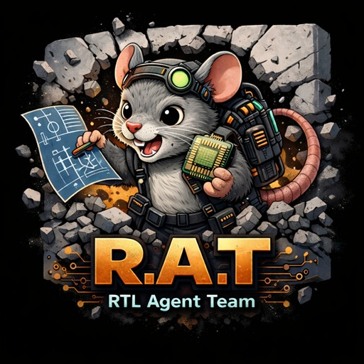
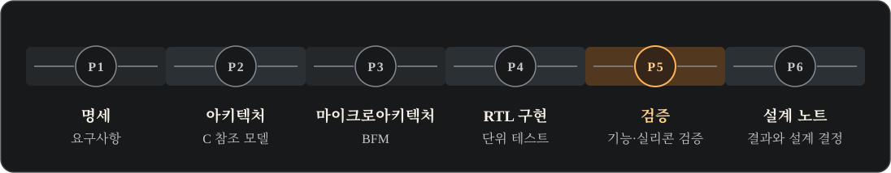

[English](README.md)

# RTL Agent Team



RTL 설계와 검증을 위한 Claude Code 플러그인입니다. 91개 전문 AI 에이전트와 56개 스킬을 제공합니다.



전체 흐름을 실행하면 설계 문서, RTL, 테스트벤치가 생성되고, 검증 결과는 설계 노트에 정리됩니다.

## 빠른 시작

**설계에 앞서 EDA 실행 환경부터 확인하세요.** 린트·시뮬레이션·합성은 해당 단계에 필요한 도구가 실제로 실행되어야 검증 결과를 남길 수 있습니다. [EDA 설정 가이드](plugin_docs/eda-setup-guide.md)

Claude Code에서 배포 버전(v0.14.6)을 설치합니다.

```text
/plugin marketplace add babyworm/rtl-agent-team
/plugin install rtl-agent-team
```

RTL 프로젝트 디렉토리에서 도구를 준비하고 프로젝트를 초기화한 뒤, 명세를
지정해 설계를 시작합니다.

```text
/rtl-agent-team:rat-setup
/rtl-agent-team:rat-init-project
/rtl-agent-team:rat-auto-design specs/design.md
```

원격 EDA를 사용할 때는 `rat-setup`에 SSH 별칭과 실행할 단계를 알려 주세요.
필요하면 사이트 초기화 스크립트도 지정합니다. 개인 기본 사이트는 프로젝트
초기화 전에도 사용할 수 있습니다. 접속 정보는 플러그인 저장소 밖에 보관합니다. [EDA 및 Docker 설정](plugin_docs/eda-setup-guide.md)

## 주요 명령

| 명령 | 용도 |
| --- | --- |
| [`rat-setup`](skills/rat-setup/SKILL.md) | 실행 환경에서 필요한 EDA 도구가 동작하는지 확인합니다. |
| [`rat-init-project`](skills/rat-init-project/SKILL.md) | 프로젝트 구조와 도구 설정, 실행 스크립트를 준비합니다. |
| [`rat-doctor`](skills/rat-doctor/SKILL.md) | 설정 후 동작이 이상할 때 플러그인과 프로젝트 설정을 점검하고 잘못된 항목을 고칩니다. |
| [`rat-auto-design`](skills/rat-auto-design/SKILL.md) | 명세를 바탕으로 P1~P6 전체를 실행합니다. |
| [`rat-refc-to-p5`](skills/rat-refc-to-p5/SKILL.md) | 기존 동작 모델(C)을 RTL로 구현하고 P5까지 검증합니다. [`try-2.0` 브랜치](CONTRIBUTING_kr.md#개발-환경-셋업) 전용 명령입니다. |
| [`rat-dse`](skills/rat-dse/SKILL.md) | 마이크로아키텍처와 BFM까지 설계 대안을 탐색합니다. |
| [`rat-p1p3-spec-uarch`](skills/rat-p1p3-spec-uarch/SKILL.md) | RTL 구현 전에 검토할 설계 문서를 작성합니다. |
| [`rat-p4p5-impl-verify`](skills/rat-p4p5-impl-verify/SKILL.md) | 승인된 마이크로아키텍처를 바탕으로 RTL을 구현하고 검증합니다. |
| [`rtl-lint-check`](skills/rtl-lint-check/SKILL.md) | RTL 린트를 실행하고 발견한 문제를 보고합니다. |
| [`rtl-p5s-func-verify`](skills/rtl-p5s-func-verify/SKILL.md) | cocotb로 RTL 결과를 참조 모델과 비교합니다. |
| [`rtl-p5a-functional-closure`](skills/rtl-p5a-functional-closure/SKILL.md) | 기능 회귀를 실행하고 커버리지와 요구사항 추적성을 확인합니다. |
| [`rtl-p5b-silicon-validation`](skills/rtl-p5b-silicon-validation/SKILL.md) | P5A 통과 후 합성·타이밍·CDC를 확인합니다. |
| [`codex-cross-review`](skills/codex-cross-review/SKILL.md) | 완료된 단계의 산출물을 Codex로 교차검증합니다. |

스킬 이름 앞에 `/rtl-agent-team:`을 붙여 실행합니다. 전체 자동화는 팀 도구를
사용할 수 있을 때 팀 모드로 진행하며, Phase 5는 통합 검증을 실행합니다.
순차 실행은 `--no-team`을 지정합니다. 같은 명령으로 재개하면 유효한 검증
결과를 재사용합니다.

Codex 교차검증은 기본적으로 꺼져 있습니다. 실행할 때 전체 또는 특정 단계의
교차검증을 요청하거나, 프로젝트의 `rat_config.json`에서
`review.codex_cross_review`를 `true`로 설정합니다. [교차검증 동작](runtime/phase-dispatch.md)

## 참고 문서

- [개발자 가이드](CONTRIBUTING_kr.md#개발-환경-셋업) · [테스트](tests/README_kr.md)
- [기술 문서](plugin_docs/README.md) · [모델 선택](runtime/model-selection.md)
- [변경 이력](CHANGELOG.md) · [MIT 라이선스](LICENSE)
