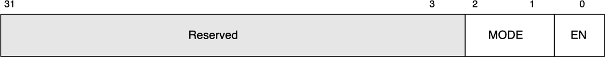

# RTL Documentation Conventions

A quick reference for filling `<!-- LLM_FILL: ... -->` markers and choosing
visual elements in `docs/rtl/{module}.md`. Stays under 200 lines so it can be
consulted in one read.

## 1. Naming

| Element | Convention | Example |
|---------|-----------|---------|
| Port direction prefix | `i_`, `o_`, `io_` (NOT suffix) | `i_data`, `o_valid` |
| Clock port | `clk` (single) or `{domain}_clk` | `sys_clk`, `pixel_clk` |
| Reset port | `rst_n` (single) or `{domain}_rst_n` (active-low async) | `sys_rst_n` |
| Instance | `u_*` prefix | `u_range_coder` |
| Parameter | `UPPER_SNAKE_CASE` | `DATA_WIDTH` |
| Localparam | `L_*` prefix, `UPPER_SNAKE_CASE` | `L_FIFO_DEPTH` |
| FSM state | `ST_*` prefix, `UPPER_SNAKE_CASE` | `ST_IDLE`, `ST_ENCODE` |

If a violation is recorded in the generated doc's banner, do not rewrite the
RTL — surface it for the human RTL engineer.

## 2. Table formats

### Port table column order

`Port Name | Direction | Width | Clock Domain | Kind | Description`

`Kind` is one of `clock`, `reset`, `data`, `protocol`. The renderer fills
`clock` and `reset` automatically based on naming; `data` is the default;
`protocol` should be applied by the LLM when filling marker descriptions for
AXI/AHB/APB signals.

### Parameter table

`Parameter | Type | Default | Description`

### Instance table

`Instance | Module | Purpose`

## 3. Figures

Reader-facing docs (`docs/rtl/{module}.md`, a design note) author each figure
as SVG and insert the PNG.

If a diagram-design skill is available, use it to draw the SVG. Otherwise
draw the SVG.

ARM Developer's Guide style: white background, thin black strokes, left-to-right
data flow, nested rectangles, signal names on the wires. Number the figure and
give it a one-line caption:

``

Keep the SVG beside the PNG. Convert with the first tool present:

`rsvg-convert -o figures/name.png figures/name.svg`

`magick figures/name.svg figures/name.png`

If neither tool exists, or the conversion fails, say so and keep the SVG. Do not paste SVG source into
the markdown. Do not leave a D2 or Mermaid fence as the published figure.

A register is a bit-field bar. MSB is on the left. Bit numbers sit above the
cells. One box per field. Reserved uses a light gray fill.

Architecture and μArch working notes still use D2 for block diagrams and
Mermaid for an FSM or a flow.

## 4. Length

Write so the page can be scanned.

- The heading states the point. The first sentence is the conclusion.
- At most three sentences in a paragraph. One idea per section.
- Prefer a table or a figure to a paragraph. Do not restate the heading.
- Overview: 100-200 characters. State the module's responsibility.
- Per-state description: 1-2 lines. What the state does, and what leaves it.
- Per-port description: 1 line. Skip it when the name is already the meaning
  (for example `i_valid`).
- Design Notes: only for a property the code does not show on its own.

## 5. Registers

Every register states its name, offset, access (`RW`, `RO`, `WO`, `RW1C`, …),
and reset. Then a bit-field figure and one row per field, including reserved.

| Field | Bits | Access | Reset | Description |
|-------|------|--------|-------|-------------|
| EN | 0 | RW | 0 | Write 1 enables the block. Read returns the stored bit. |
| MODE | 2:1 | RW | 0 | Write selects the mode. Read returns the stored mode. |
| Reserved | 31:3 | RO | 0 | Write ignored. Read returns 0. |

The CTRL rows above are the format sample for the figure. Copy the columns,
not the fields.

Use the access, reset, and width the RTL or the spec already gives, and still
say what a read returns and what a write does. If a bit is unused, name it
Reserved, access RO, reset 0, write ignored, read 0. If access or reset is
not stated, choose a reasonable value, write that the choice was made in this
doc, and explain the effect. Do not invent a field the register does not have.
Do not leave a field unexplained. A module with no register says `_None._`.

## 6. Anti-patterns

- Leaving `<!-- LLM_FILL: ... -->` markers in the committed doc — fail.
- Leaving `{{PLACEHOLDER}}` strings — fail (the renderer should have
  replaced them; if any remain, fix the renderer or the JSON instead).
- Restating the port name in its description ("i_valid — input valid signal").
- Inventing port descriptions when no comment or naming clue exists. Leave
  the cell blank rather than fabricating.
- Leaving a register field without bits, access, reset, or its read and write
  effect. Decide the field. Do not invent a field the register does not have.
- Publishing a D2 or Mermaid fence as the figure. Author SVG, insert PNG.
- Writing "TODO" inside the doc body. If something cannot be documented yet,
  remove the corresponding section and note absence in the document footer.
